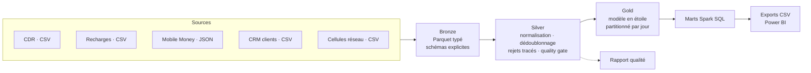
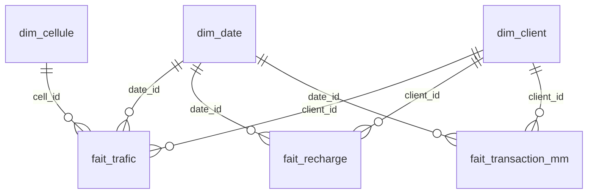

# Pipeline Big Data télécom — CDR, recharges et Mobile Money (PySpark)

Pipeline de données de bout en bout qui transforme l'activité brute d'un opérateur
télécom (appels, SMS, data, recharges, transactions Mobile Money) en un **modèle en
étoile** et en **tableaux analytiques prêts pour Power BI**, avec PySpark et Spark SQL.

> Les données sont synthétiques, générées par Spark, avec des défauts de qualité
> injectés volontairement (doublons, numéros mal formatés, dates corrompues, montants
> négatifs). Tarifs et répartitions sont fictifs.

## Architecture



| Couche | Rôle | Points techniques |
| --- | --- | --- |
| **Bronze** | Copie fidèle des sources en Parquet | Schémas `StructType` déclarés (pas d'inférence), traçabilité du fichier source et de l'heure d'ingestion |
| **Silver** | Données fiables | MSISDN normalisés (`+221`, `00221`, espaces → 9 chiffres), dédoublonnage par identifiant, règles de validation ordonnées, **lignes rejetées conservées avec leur motif**, partitionnement par `event_date` |
| **Quality gate** | Protéger le reporting | Rapport `reports/qualite_silver.md` à chaque exécution ; le pipeline **s'arrête** si une table dépasse 5 % de lignes écartées |
| **Gold** | Modèle en étoile | `dim_date`, `dim_client`, `dim_cellule` ; `fait_trafic`, `fait_recharge`, `fait_transaction_mm` ; rattachement MSISDN → client par **broadcast join** ; membre « Inconnu » (`-1`) pour ne perdre aucun événement |
| **Marts** | Restitution | Requêtes Spark SQL paramétrées (`:date_fin`), exportées en Parquet et en CSV pour Power BI |

### Modèle en étoile



### Marts analytiques ([`sql/marts`](sql/marts))

| Mart | Contenu | Techniques SQL |
| --- | --- | --- |
| `kpi_journalier_region` | Clients actifs, minutes, SMS, data, revenu, recharges, Mobile Money par jour et par région | CTE, agrégations conditionnelles, `COUNT(DISTINCT)` |
| `vue_360_client` | Une ligne par abonné : usage, revenu, cellule principale, inactivité, **statut d'engagement** (actif, faible usage, à risque de churn) et décile de valeur | `ROW_NUMBER`, `NTILE`, `GREATEST`, paramètres nommés |
| `arpu_offre_segment` | ARPU, revenu médian et part du revenu par offre et segment | `PERCENTILE_APPROX`, fenêtre `SUM() OVER ()` |

## Exécution

### GitHub Actions

Chaque push lance les tests puis le pipeline complet. Le rapport qualité s'affiche
dans le résumé de l'exécution ; rapports et exports Power BI sont téléchargeables
dans les artefacts.

### En local (Docker)

```bash
docker compose build
docker compose run --rm tests        # tests unitaires
docker compose up pipeline           # pipeline complet, Spark UI sur http://localhost:4040
```

### En local (Python 3.11 + Java 17)

```bash
pip install -r requirements.txt
pytest -q
PYTHONPATH=src spark-submit src/main.py --step all       # ou --step bronze|silver|gold|marts
```

Les volumes se règlent dans [`config/pipeline.yaml`](config/pipeline.yaml) : de quelques
milliers à plusieurs dizaines de millions d'événements.

### Orchestration Airflow

[`airflow/dags/telecom_spark_pipeline.py`](airflow/dags/telecom_spark_pipeline.py) : une
tâche `spark-submit` par couche, exécution quotidienne, 2 reprises automatiques. Un
échec du quality gate bloque la publication des marts.

## Structure

```
config/pipeline.yaml        paramètres (période, volumes, chemins, seuil qualité)
src/telecom_pipeline/
    generate.py             génération des sources synthétiques avec Spark
    bronze.py               ingestion avec schémas explicites
    silver.py               nettoyage, validation, rejets, rapport et quality gate
    gold.py                 modèle en étoile
    marts.py                exécution des requêtes Spark SQL et exports
    run.py                  point d'entrée (--step)
sql/marts/                  requêtes analytiques
airflow/dags/               DAG d'orchestration
tests/                      tests pytest (Silver, Gold, marts)
```
